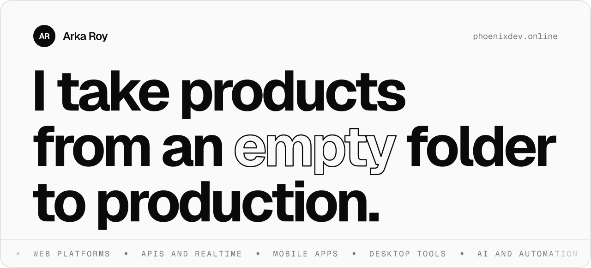
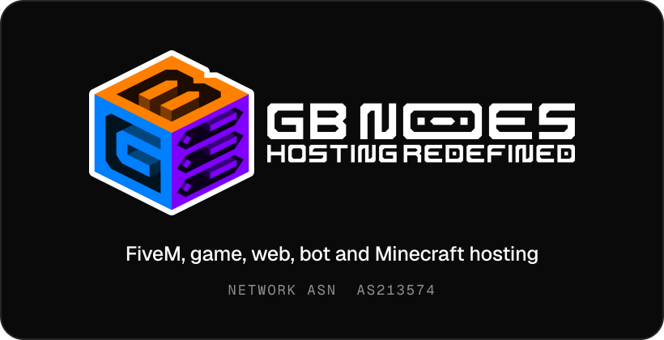
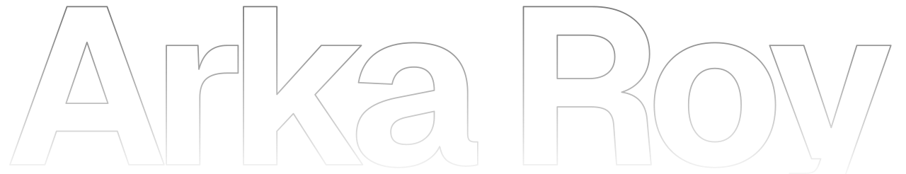

<a href="https://phoenixdev.online"><picture><source media="(prefers-color-scheme: dark)" srcset="assets/header-dark.svg"></picture></a>

<table>
<tr>
<td rowspan="2" width="424" valign="top">
<samp>ABOUT</samp> 
I'm <b>Arka Roy</b>, a full-stack developer. Online I go by <b>Phoenix</b>.
  
I build SaaS products, mobile apps, CMS-driven sites and business automations, and I like owning the work end to end, from the database schema to the launch video.
</td>
<td width="211" valign="top"><samp>BASED IN</samp> <b>India</b> IST, UTC+5:30</td>
<td width="211" valign="top"><samp>OPEN TO</samp> <b>Freelance, full-time</b> Remote</td>
</tr>
<tr>
<td valign="top"><samp>FOUNDER OF</samp> <b><a href="https://store.pxscripts.in">PX Scripts</a></b> and <a href="https://starflares.com">Starflares</a></td>
<td valign="top"><samp>PARTNER AT</samp> <b><a href="https://mindfrix.com">MindFrix</a></b> Senior developer</td>
</tr>
</table>

 

<samp>WHAT I WORK WITH</samp>

<!-- stack:start -->
<table>
<tr>
<td width="150" valign="top"><b>Languages</b></td>
<td>
<picture><source media="(prefers-color-scheme: dark)" srcset="assets/chips/dark/typescript.svg"></picture>
<picture><source media="(prefers-color-scheme: dark)" srcset="assets/chips/dark/javascript.svg"></picture>
<picture><source media="(prefers-color-scheme: dark)" srcset="assets/chips/dark/python.svg"></picture>
<picture><source media="(prefers-color-scheme: dark)" srcset="assets/chips/dark/dart.svg"></picture>
<picture><source media="(prefers-color-scheme: dark)" srcset="assets/chips/dark/lua.svg"></picture>
<picture><source media="(prefers-color-scheme: dark)" srcset="assets/chips/dark/csharp.svg"></picture>
</td>
</tr>
<tr>
<td width="150" valign="top"><b>Frontend</b></td>
<td>
<picture><source media="(prefers-color-scheme: dark)" srcset="assets/chips/dark/react.svg"></picture>
<picture><source media="(prefers-color-scheme: dark)" srcset="assets/chips/dark/next-js.svg"></picture>
<picture><source media="(prefers-color-scheme: dark)" srcset="assets/chips/dark/tailwind-css.svg"></picture>
<picture><source media="(prefers-color-scheme: dark)" srcset="assets/chips/dark/vite.svg"></picture>
<picture><source media="(prefers-color-scheme: dark)" srcset="assets/chips/dark/shadcn-ui.svg"></picture>
<picture><source media="(prefers-color-scheme: dark)" srcset="assets/chips/dark/gsap.svg"></picture>
<picture><source media="(prefers-color-scheme: dark)" srcset="assets/chips/dark/motion.svg"></picture>
<picture><source media="(prefers-color-scheme: dark)" srcset="assets/chips/dark/three-js.svg"></picture>
</td>
</tr>
<tr>
<td width="150" valign="top"><b>Backend</b></td>
<td>
<picture><source media="(prefers-color-scheme: dark)" srcset="assets/chips/dark/node-js.svg"></picture>
<picture><source media="(prefers-color-scheme: dark)" srcset="assets/chips/dark/bun.svg"></picture>
<picture><source media="(prefers-color-scheme: dark)" srcset="assets/chips/dark/hono.svg"></picture>
<picture><source media="(prefers-color-scheme: dark)" srcset="assets/chips/dark/express.svg"></picture>
<picture><source media="(prefers-color-scheme: dark)" srcset="assets/chips/dark/fastapi.svg"></picture>
<picture><source media="(prefers-color-scheme: dark)" srcset="assets/chips/dark/socket-io.svg"></picture>
<picture><source media="(prefers-color-scheme: dark)" srcset="assets/chips/dark/graphql.svg"></picture>
<picture><source media="(prefers-color-scheme: dark)" srcset="assets/chips/dark/zod.svg"></picture>
<picture><source media="(prefers-color-scheme: dark)" srcset="assets/chips/dark/better-auth.svg"></picture>
</td>
</tr>
<tr>
<td width="150" valign="top"><b>Data</b></td>
<td>
<picture><source media="(prefers-color-scheme: dark)" srcset="assets/chips/dark/postgresql.svg"></picture>
<picture><source media="(prefers-color-scheme: dark)" srcset="assets/chips/dark/drizzle.svg"></picture>
<picture><source media="(prefers-color-scheme: dark)" srcset="assets/chips/dark/prisma.svg"></picture>
<picture><source media="(prefers-color-scheme: dark)" srcset="assets/chips/dark/payload-cms.svg"></picture>
<picture><source media="(prefers-color-scheme: dark)" srcset="assets/chips/dark/mongodb.svg"></picture>
<picture><source media="(prefers-color-scheme: dark)" srcset="assets/chips/dark/mysql.svg"></picture>
<picture><source media="(prefers-color-scheme: dark)" srcset="assets/chips/dark/redis.svg"></picture>
<picture><source media="(prefers-color-scheme: dark)" srcset="assets/chips/dark/supabase.svg"></picture>
<picture><source media="(prefers-color-scheme: dark)" srcset="assets/chips/dark/firebase.svg"></picture>
<picture><source media="(prefers-color-scheme: dark)" srcset="assets/chips/dark/pocketbase.svg"></picture>
</td>
</tr>
<tr>
<td width="150" valign="top"><b>Mobile and desktop</b></td>
<td>
<picture><source media="(prefers-color-scheme: dark)" srcset="assets/chips/dark/flutter.svg"></picture>
<picture><source media="(prefers-color-scheme: dark)" srcset="assets/chips/dark/react-native.svg"></picture>
<picture><source media="(prefers-color-scheme: dark)" srcset="assets/chips/dark/expo.svg"></picture>
<picture><source media="(prefers-color-scheme: dark)" srcset="assets/chips/dark/capacitor.svg"></picture>
<picture><source media="(prefers-color-scheme: dark)" srcset="assets/chips/dark/electron.svg"></picture>
<picture><source media="(prefers-color-scheme: dark)" srcset="assets/chips/dark/net.svg"></picture>
</td>
</tr>
<tr>
<td width="150" valign="top"><b>Game and creative</b></td>
<td>
<picture><source media="(prefers-color-scheme: dark)" srcset="assets/chips/dark/fivem.svg"></picture>
<picture><source media="(prefers-color-scheme: dark)" srcset="assets/chips/dark/tebex.svg"></picture>
<picture><source media="(prefers-color-scheme: dark)" srcset="assets/chips/dark/discord-js.svg"></picture>
<picture><source media="(prefers-color-scheme: dark)" srcset="assets/chips/dark/godot.svg"></picture>
<picture><source media="(prefers-color-scheme: dark)" srcset="assets/chips/dark/unity.svg"></picture>
<picture><source media="(prefers-color-scheme: dark)" srcset="assets/chips/dark/blender.svg"></picture>
<picture><source media="(prefers-color-scheme: dark)" srcset="assets/chips/dark/remotion.svg"></picture>
<picture><source media="(prefers-color-scheme: dark)" srcset="assets/chips/dark/rive.svg"></picture>
</td>
</tr>
<tr>
<td width="150" valign="top"><b>AI and automation</b></td>
<td>
<picture><source media="(prefers-color-scheme: dark)" srcset="assets/chips/dark/claude.svg"></picture>
<picture><source media="(prefers-color-scheme: dark)" srcset="assets/chips/dark/gemini.svg"></picture>
<picture><source media="(prefers-color-scheme: dark)" srcset="assets/chips/dark/playwright.svg"></picture>
<picture><source media="(prefers-color-scheme: dark)" srcset="assets/chips/dark/puppeteer.svg"></picture>
</td>
</tr>
<tr>
<td width="150" valign="top"><b>Shipping</b></td>
<td>
<picture><source media="(prefers-color-scheme: dark)" srcset="assets/chips/dark/linux.svg"></picture>
<picture><source media="(prefers-color-scheme: dark)" srcset="assets/chips/dark/docker.svg"></picture>
<picture><source media="(prefers-color-scheme: dark)" srcset="assets/chips/dark/caddy.svg"></picture>
<picture><source media="(prefers-color-scheme: dark)" srcset="assets/chips/dark/pm2.svg"></picture>
<picture><source media="(prefers-color-scheme: dark)" srcset="assets/chips/dark/vercel.svg"></picture>
<picture><source media="(prefers-color-scheme: dark)" srcset="assets/chips/dark/railway.svg"></picture>
<picture><source media="(prefers-color-scheme: dark)" srcset="assets/chips/dark/github.svg"></picture>
<picture><source media="(prefers-color-scheme: dark)" srcset="assets/chips/dark/git.svg"></picture>
<picture><source media="(prefers-color-scheme: dark)" srcset="assets/chips/dark/pnpm.svg"></picture>
<picture><source media="(prefers-color-scheme: dark)" srcset="assets/chips/dark/vitest.svg"></picture>
</td>
</tr>
</table>
<!-- stack:end -->

 

<table>
<tr>
<td width="423" valign="top">
<samp>ON DISCORD</samp>  

</td>
<td width="423" valign="top">
<samp>HOSTING PARTNER</samp>  

</td>
</tr>
</table>

 

<samp>FIND ME</samp>

<table>
<tr>
<td width="212" valign="top"><samp>PORTFOLIO</samp> <b><a href="https://phoenixdev.online">phoenixdev.online</a></b></td>
<td width="212" valign="top"><samp>WRITING</samp> <b><a href="https://phoenixdev.online/blog">Blog</a></b></td>
<td width="212" valign="top"><samp>CHAT</samp> <b><a href="https://discord.gg/EvnYVr4S7Y">Discord</a></b></td>
<td width="212" valign="top"><samp>STORE</samp> <b><a href="https://store.pxscripts.in">PX Scripts</a></b></td>
</tr>
</table>

<picture><source media="(prefers-color-scheme: dark)" srcset="assets/footer-dark.svg"></picture>
